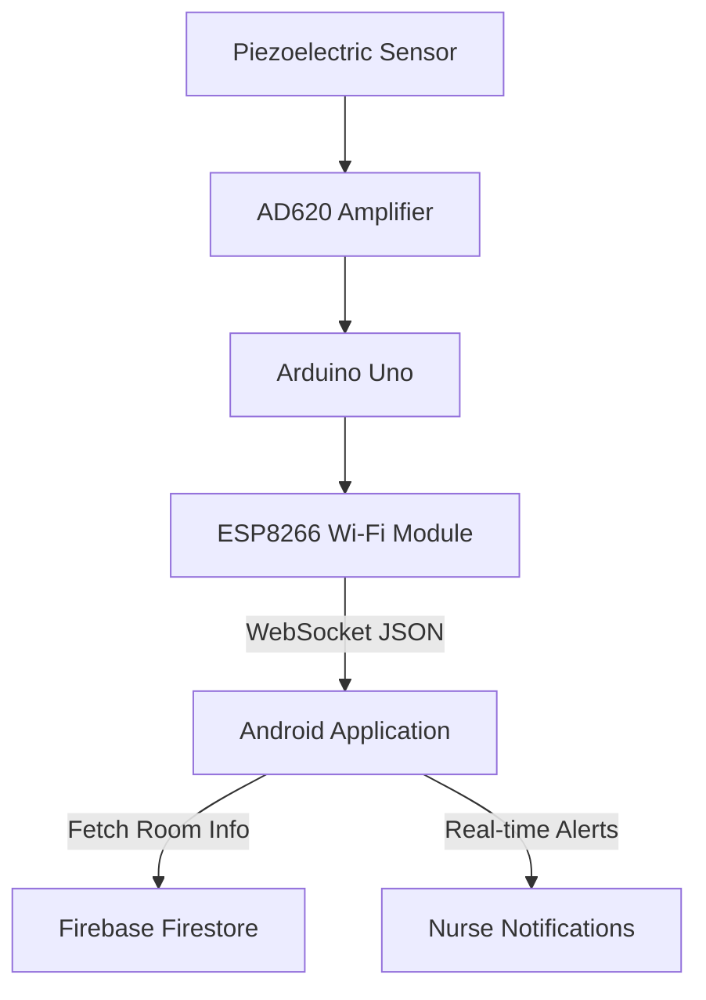
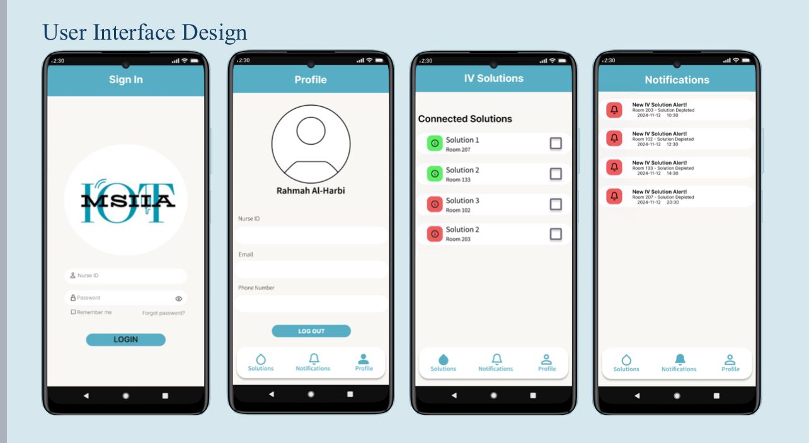

# IOT-MSIIA | IoT-Based IV Monitoring System

<p align="center">
  
</p>

<p align="center">
  An IoT-based graduation project for monitoring intravenous (IV) fluid levels through connected hardware, cloud services, and an Android application.
</p>

<p align="center">
  
  
  
  
  
</p>

---

## Table of Contents

- [Overview](#overview)
- [The Problem](#the-problem)
- [System Architecture](#system-architecture)
- [Key Features](#key-features)
- [Technology Stack](#technology-stack)
- [Android Application](#android-application)
- [Repository Structure](#repository-structure)
- [Getting Started](#getting-started)
- [Usability Study](#usability-study)
- [Limitations](#limitations)
- [Academic Information](#academic-information)

## Overview

**IOT-MSIIA** is a graduation project developed at Taibah University to explore the use of Internet of Things (IoT) technology for monitoring intravenous (IV) fluid levels.

The system combines a piezoelectric sensor, an AD620 amplifier, an Arduino-based setup, ESP8266 wireless connectivity, Firebase services, and an Android application to make IV monitoring information accessible through a connected interface.

The project brings together hardware, mobile development, and cloud integration in an end-to-end prototype.

## The Problem

IV fluid levels require regular monitoring during administration. Depending exclusively on manual checks can make continuous monitoring challenging in environments where caregivers attend to multiple patients. Furthermore, existing alert devices are often noisy and unreliable, causing unnecessary discomfort to patients.

IOT-MSIIA explores a connected approach that helps make IV fluid status available through a mobile application and supports alerts when relevant fluid-level conditions require attention.

## System Architecture

The system connects the hardware monitoring unit with wireless communication, cloud services, and the Android application.



The diagram provides a high-level overview. The ESP8266 acts as a WebSocket server, transmitting structured JSON data directly to the Android app, which then queries Firestore to map the sensor to a specific hospital room.

## Key Features

- **Real-time Detection:** Monitors droplet vibrations using a piezoelectric sensor amplified by an AD620 circuit.
- **Structured Data Pipeline:** Arduino processes analog signals into structured JSON and sends it via WebSocket.
- **Cloud Storage:** Android app receives JSON, maps the sensor to a room number, and stores it in **Firebase Firestore**.
- **Nurse-Centric UI:** Android app features real-time notifications, active/stopped solutions lists, and a profile management interface.
- **High Accuracy:** Achieved a detection accuracy of **95.6%** across 50+ hardware trials with a latency of **<5 seconds**.

## Technology Stack

| Technology | Purpose |
|---|---|
| Java | Android application development |
| Android SDK | Mobile application platform |
| Arduino | Hardware-side processing |
| ESP8266 | Wireless connectivity |
| Firebase Firestore | Cloud data integration |

## Android Application

The Android application provides the mobile interface for the monitoring system.

The available Android source code includes:

- `MainActivity.java` — Main application activity.
- `Solution.java` — Model for IV solution information.
- `SolutionAdapter.java` — Adapter for displaying solution entries.
- Android layouts and resources for the application interface.
- Firebase Firestore integration for retrieving solution information.

The available code references the `ActiveSolutions` collection and the `IV1` document, including the `name` and `checked` fields.

### Application Screenshots

<p align="center">
  
</p>

## Repository Structure

```text
IOT-MSIIA/
├── app/
│   └── src/
│       ├── main/
│       │   ├── java/
│       │   │   └── com/example/iot_msiia/
│       │   │       ├── MainActivity.java
│       │   │       ├── Solution.java
│       │   │       └── SolutionAdapter.java
│       │   ├── res/
│       │   └── AndroidManifest.xml
│       ├── test/
│       └── androidTest/
├── gradle/
├── docs/
│   ├── iot_msiia_logo.png
│   └── screenshots/
├── build.gradle.kts
├── settings.gradle.kts
├── gradle.properties
├── .gitignore
└── README.md
```

The structure above represents the Android project and documentation. Add the hardware firmware and circuit documentation if those files are available and intended to be part of the public repository.

## Getting Started

### Prerequisites

- Android Studio
- A compatible JDK and Android SDK
- A configured Firebase project

### Setup

1. Clone the repository.

   ```bash
   git clone <repository-url>
   cd IOT-MSIIA
   ```

2. Open the project in Android Studio.

3. Configure the Firebase project and provide the appropriate Android configuration file.

4. Sync the Gradle project and resolve any required dependencies.

5. Build and run the application on a compatible Android device or emulator.

**Note:** Running the Android application does not, by itself, reproduce the complete hardware monitoring workflow. The corresponding hardware, firmware, and service configuration are required for end-to-end operation.

## Usability Study

A study involving **97 participants** was conducted as part of the graduation project to gather user input and inform system requirements and usability evaluation.

The detailed methodology, participant characteristics, and findings should be included in the project report or summarized here when the results are available for publication.

## Limitations

IOT-MSIIA was developed as an academic prototype.

The project description and reported functionality should not be interpreted as evidence of clinical validation or certification. Any use in a clinical environment would require appropriate technical, safety, and clinical evaluation.

## Team & Academic Information

- **Institution:** Taibah University
- **Department:** College of Computer Science and Engineering
- **Project type:** Graduation Project
- **Project period:** September 2024 – May 2025
- **Supervisor:** Dr. Rugayya Abdulrahman

**Team Members:**
- Nouf Musaad Alharbi
- Lama Abdullatif Alruwaytie
- Shahad Abed Alluhaybi
- Rafagh Sami Aloufi
- Rafaa Omar Alalawi
